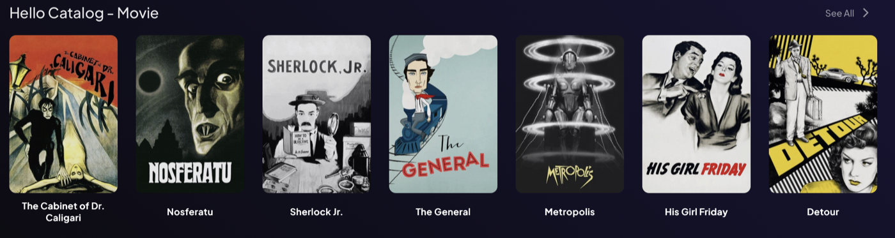
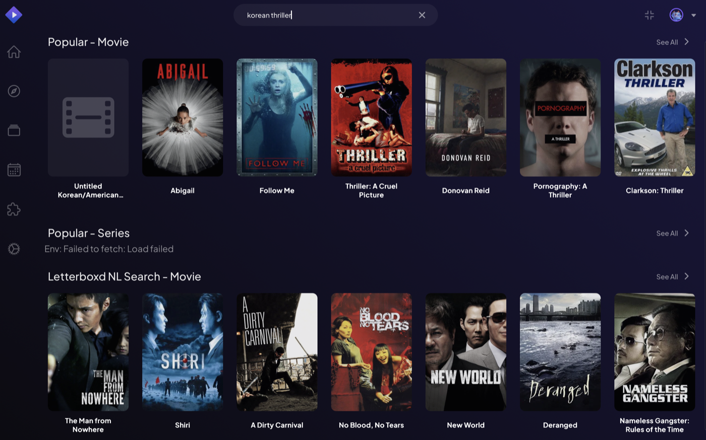

# Showcase

Add-ons built with Addon Forge. Built one? Add it with a pull request: copy the entry format below, and check the requirements in [`CONTRIBUTING.md`](CONTRIBUTING.md#sharing-your-add-on-in-the-showcase).

<!--
Entry format (keep the screenshot at most 1400 px wide):

### Add-on name

One or two sentences: what it does, for whom. **Provides:** catalog / subtitles / … · **Data:** source(s) · **Built with:** assistant name · [Repository](https://github.com/you/your-addon)
-->

## Examples in this repository

### Hello Catalog

Ten public-domain films, searchable and filterable by genre: the smallest complete add-on, and the first one to try. **Provides:** catalog · **Data:** a built-in list · [Source](examples/hello-catalog/)

### Letterboxd NL Search

Search films in plain language ("slow-burn 70s thrillers set in Paris"), with a keyword, Anthropic, OpenAI or local Ollama backend, personalised with your own Letterboxd export. **Provides:** search-only catalog · **Data:** built-in list, Cinemeta, your Letterboxd export, an LLM · [Source](examples/letterboxd-nl-search/)

## Community add-ons

None yet: yours could be the first.
