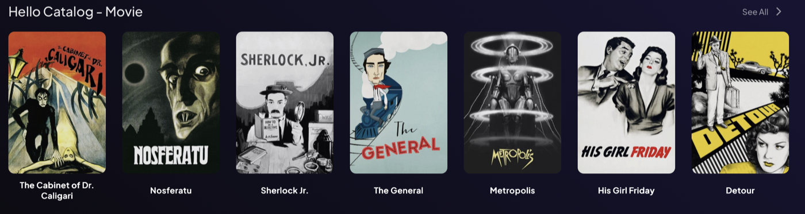

# Hello Catalog

A small catalog of public-domain films. No configuration, no API keys.

It is Addon Forge's "first run" demo and the baseline every CI run validates and smoke-tests. Built on the official [stremio-addon-sdk](https://github.com/Stremio/stremio-addon-sdk).



## What it does

- Adds a **Hello Catalog** row of 10 films to Stremio's Board and Discover pages.
- **Search:** its films appear in Stremio's search results when the title matches.
- **Genre filter:** the Discover page can filter it by genre.
- Uses IMDb ids (`tt…`), so Stremio's own Cinemeta add-on supplies the details page (synopsis, cast, etc.). This add-on serves no streams.

| | |
|---|---|
| Resources | catalog |
| Content types | movie |
| Catalog features | search, genre |
| Configuration | none |

## Data source and terms

- **The list of films** is built into [`src/sources/public-domain.js`](src/sources/public-domain.js): films that are in the public domain in the United States (for example *Night of the Living Dead*, *Nosferatu*, *His Girl Friday*).
- **Posters** are loaded by Stremio from `images.metahub.space`, the image service Cinemeta uses.
- **Details pages** come from Cinemeta, which Stremio includes by default.

## Run it

From this folder, with Docker:

```bash
docker compose up -d --build
```

Or without Docker:

```bash
npm install
npm start
```

Then, from the Addon Forge root folder, check it and get the install link:

```bash
node tools/forge.js validate http://127.0.0.1:7100
```

```bash
node tools/forge.js smoke http://127.0.0.1:7100
```

```bash
node tools/forge.js install-link http://127.0.0.1:7100
```

To use it on a TV or phone, see [`docs/hosting.md`](../../docs/hosting.md).

## Develop

```bash
npm test
```

- `src/manifest.js`: what the add-on declares to Stremio
- `src/addon.js`: request handlers (search and genre filtering happen here)
- `src/sources/public-domain.js`: the film list
- `test/`: handler tests with a mocked source
