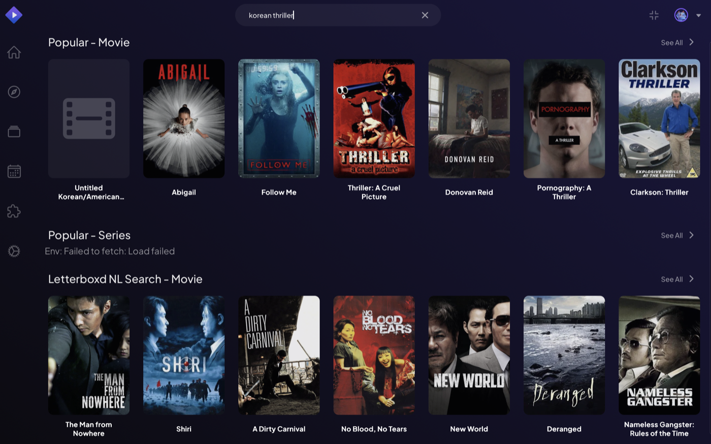
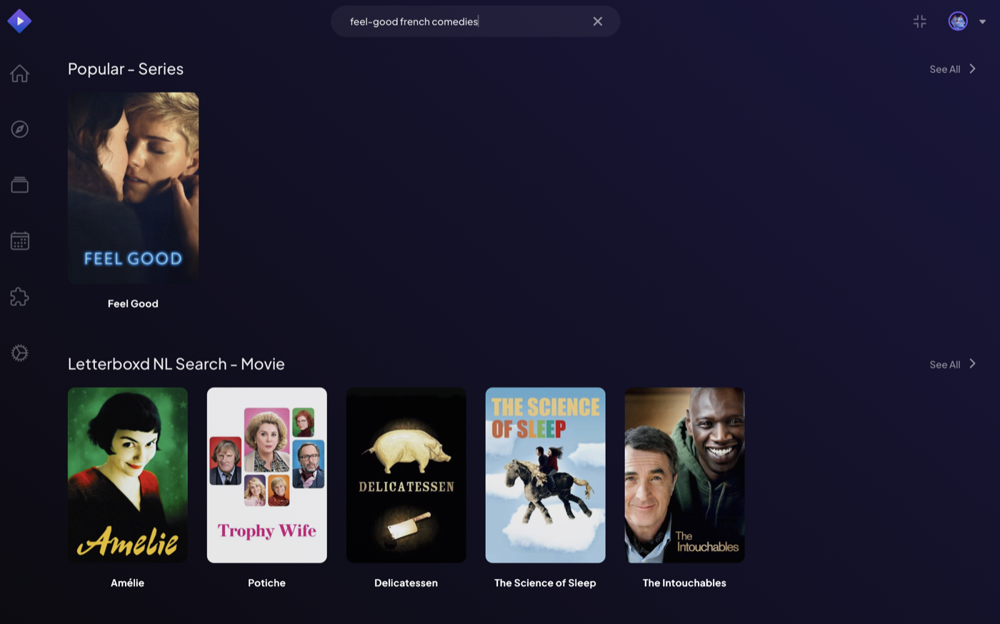
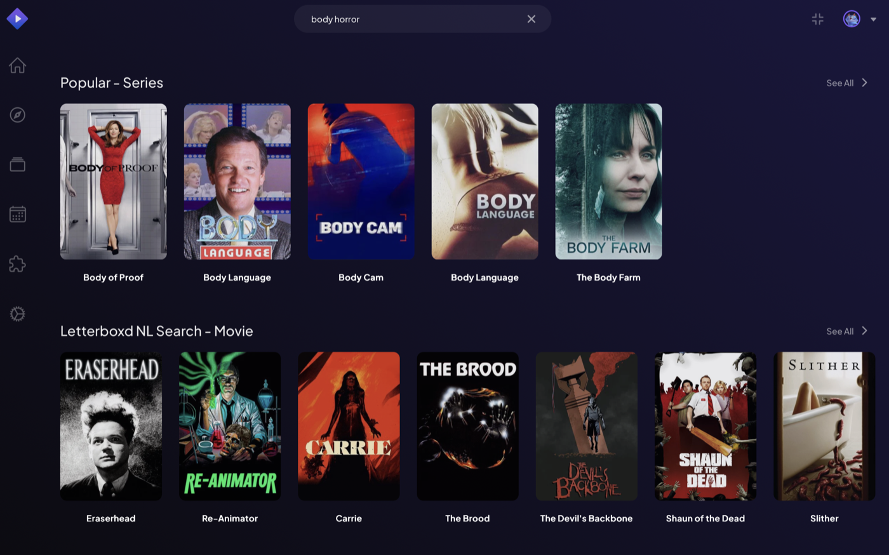

# Letterboxd NL Search

Search films in plain language in Stremio's search bar: *"slow-burn 70s thrillers set in Paris"*, *"cozy Japanese animation"*, *"heist films like Rififi"*. Optionally personalised with your own Letterboxd export: films you've already seen are hidden, and your favourites steer the suggestions.

A Stremio add-on built with [Addon Forge](https://github.com/elouanzer/addonforge) on the official [stremio-addon-sdk](https://github.com/Stremio/stremio-addon-sdk). Addon Forge and this example are independent community projects, **not affiliated with Letterboxd or Stremio**.



<details>
<summary>More searches (Ollama, llama3.1:8b, films already seen on Letterboxd hidden)</summary>

"feel-good french comedies":



"body horror":



</details>

## What it does

- Adds a **search-only movie catalog**: nothing on your Board; type a search and a "Letterboxd NL Search" row appears among the results.
- Results use IMDb ids, so Stremio's Cinemeta add-on shows the usual details page. This add-on serves no streams.
- Three ways to understand your search, chosen with `SEARCH_PROVIDER`:

| Backend | Needs | How it works |
|---|---|---|
| `keyword` (default) | Nothing | Reads a decade or year, genres, countries and keywords out of the search, and matches them against a built-in list of about 200 well-known films with hand-written tags (mood, setting, themes). Offline, instant, limited to that list. |
| `anthropic` | An Anthropic API key | Claude (default model `claude-haiku-5-5`) reads the search and suggests films; each title is then matched to its IMDb id on Cinemeta. Any film, any phrasing. |
| `openai` | An OpenAI API key and a model name | Same, with an OpenAI model, or any OpenAI-compatible server (`OPENAI_BASE_URL`). |
| `ollama` | [Ollama](https://ollama.com) running on your computer | Same, with a local model: free, and your searches never leave your computer. Smaller models suggest less accurately. |

What the add-on adds on top of the model:

- **Real films only.** Each suggested title must exist on Cinemeta to be shown, so invented films are dropped.
- **The search's explicit requirements are enforced.** An era ("70s", "post 2000", "before 1960"), genres ("thriller") and countries ("Korean") are checked against Cinemeta's metadata, because smaller models often ignore part of a request. "Not American" and "non-Korean" are not treated as requirements. Settings, moods and themes ("set in Paris", "slow-burn") are left to the model.
- **Enough candidates.** With a Letterboxd export, the model is asked for more films than are shown, since the obvious picks are often ones you've seen: up to 60 for a long watch history, or 40 with `ollama`, where each film adds about a second.
- **A fallback.** If an LLM call fails (no network, quota, timeout), the add-on answers with the keyword backend instead and logs why. That answer is not cached, so the next search tries the LLM again.

**Speed.** A new search takes a few seconds with `anthropic` or `openai`. With `ollama` and an 8B model on a laptop, expect 10 to 30 seconds, longer for the first search after Ollama has unloaded the model. Repeated searches are instant (cached for 6 hours). If Stremio stops waiting, search again a moment later: the add-on finishes the search in the background and caches it.

## Data sources and their terms

- **Your Letterboxd export**: files you download yourself. The add-on only reads them from your disk; it never contacts Letterboxd, whose [terms of use](https://letterboxd.com/legal/terms-of-use/) forbid scraping.
- **Cinemeta**: Stremio's public metadata add-on, used to turn titles into IMDb ids. Lookups are cached.
- **The built-in film list** (`src/sources/seed-films.json`): titles, years, genres, countries and directors from Cinemeta, plus tags written for this example. No synopses or other copyrighted text. Rebuild it from `scripts/seed-films.txt` with `node scripts/build-seed.js`.
- **The LLM provider you choose**, under its own terms: [Anthropic](https://www.anthropic.com/legal/commercial-terms), [OpenAI](https://openai.com/policies/terms-of-use/), or Ollama (local).

## Configuration

Everything is set with environment variables, in a `.env` file next to `docker-compose.yml`:

```bash
cp .env.example .env
```

`.env.example` describes each variable. The main ones:

| Variable | Default | Meaning |
|---|---|---|
| `SEARCH_PROVIDER` | `keyword` | `keyword`, `anthropic`, `openai` or `ollama` |
| `ANTHROPIC_API_KEY` / `OPENAI_API_KEY` | | The key for that provider. Stays in `.env`, which git ignores; never printed. |
| `LLM_MODEL` | `claude-haiku-5-5` (anthropic), `llama3.2` (ollama) | Required for `openai` |
| `HIDE_WATCHED` | `true` | Hide films in your Letterboxd export |
| `TASTE_HINTS` | `true` | Send your highest-rated films to the LLM (see Privacy) |
| `MAX_RESULTS` | `20` | Results per search, 1 to 50 |

Restart after changing `.env`: `docker compose up -d`. The first log line says which backend is running:

```bash
docker compose logs addon
```

### Your Letterboxd export (optional)

1. On letterboxd.com: **Settings → Data → Export your data**. You get a ZIP file.
2. Unzip it and copy `watched.csv` and `ratings.csv` into this add-on's `data/` folder.
3. Restart: `docker compose up -d --force-recreate`.

The `data/` folder is ignored by git: your export is personal data and must never be committed.

### Privacy

- With `keyword` or `ollama`, nothing about your searches or your export leaves your computer (apart from title lookups on Cinemeta for `ollama`).
- With `anthropic` or `openai`, your searches are sent to that provider. With `TASTE_HINTS=true` (the default), so are the titles and years of up to 25 films you rated 4 stars or more. Set `TASTE_HINTS=false` to keep your ratings local. Hiding watched films always happens locally.
- Searches are cached in memory for 6 hours: the same search twice costs one LLM call.

## Run it

With Docker (recommended):

```bash
docker compose up -d --build
```

Without Docker (Node 22.13 or newer):

```bash
npm install
npm start
```

Then install it in Stremio from `http://127.0.0.1:7101/manifest.json`, or print the link from the Addon Forge folder:

```bash
node tools/forge.js install-link http://127.0.0.1:7101
```

Check it with Addon Forge's tools; `--search` sends a real query instead of "test":

```bash
node tools/forge.js validate http://127.0.0.1:7101
```

```bash
node tools/forge.js smoke http://127.0.0.1:7101 --search "70s thriller"
```

To use it on other devices (TV, phone), see Addon Forge's [docs/hosting.md](../../docs/hosting.md).

## Develop

```bash
npm test
```

The tests never call an LLM or Cinemeta: providers and network calls are mocked.

- `src/addon.js`: the catalog handler
- `src/config.js`: environment variables
- `src/search/`: the pipeline (`index.js`) and its backends (`keyword.js`, `llm.js`, `anthropic.js`, `openai.js`)
- `src/sources/`: Letterboxd export reader, Cinemeta lookups, the built-in film list
- `scripts/`: rebuilds the built-in film list
